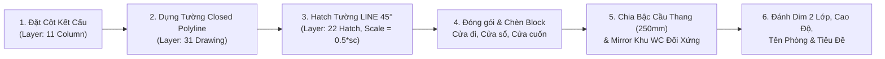

# Skill 2: Triển Khai Mặt Bằng Tầng Kiến Trúc Tổng Quát (`cad-arch-ground-plan`)

Skill này cung cấp quy trình và công thức tham số hóa tổng quát để dựng **Mặt bằng Tầng trệt / Các tầng lầu (`GROUND FLOOR PLAN` / `1ST FLOOR PLAN` / `2ND FLOOR PLAN`)** cho bất kỳ công trình nhà xưởng, nhà điều hành hoặc nhà phụ trợ nào trên AutoCAD.

---

## 1. Quy Trình 6 Bước Chuẩn Dựng Mặt Bằng Tầng



---

## 2. Hệ Cột Kết Cấu, Tường `Closed Polyline` & Hatch Mặt Cắt Tường

### A. Đặt Cột Kết Cấu (`11 Column`)
- **Layer:** `"11 Column"` (Màu 7 White, nét dày $0.35\text{ mm}$).
- **Quy tắc đặt cột:**
  - Đặt đầy đủ các cột bê tông cốt thép ($B_c \times H_c$) hoặc cột thép hình chữ H tại mọi giao điểm lưới trục theo hồ sơ kết cấu.
  - **Kiểm tra giao tuyến Cột – Tường:** Khi tường bao hoặc vách ngăn đi qua cột, **bắt buộc phải ngắt và khép kín đầu tường tại mép cột**, tuyệt đối không vẽ nét tường hoặc hatch tường đè xuyên qua tiết diện cột.

### B. Dựng Tường & Vách Ngăn (`31 Drawing` — Bắt Buộc `Closed LWPOLYLINE`)
- **Layer:** `"31 Drawing"` (Màu 7 White, nét dày $0.25\text{ mm}$).
- **Thông số bề dày tường `$WALL_THICK`:** Tường bao ngoài thường dày $200\text{ mm}$ (hoặc $220\text{ mm}$), tường ngăn phòng/khu WC dày $100\text{ mm}$ (hoặc $110\text{ mm}$).
- **Quy tắc kỹ thuật bắt buộc:**
  1. Mỗi phân đoạn tường (giữa hai cột hoặc giữa cột và khuôn cửa) phải là một đối tượng **`AcDbPolyline` (`LWPOLYLINE`) khép kín (`Closed = True`)**.
  2. Tuyệt đối không để tường dưới dạng các đoạn `LINE` rời rạc hoặc `Polyline` hở (`Closed = False`). Nếu nhận bản vẽ có nét tường rời, dùng lệnh `nn` (`joinline.lsp`) để hàn kín trước khi Hatch.
  3. Tại mọi vị trí cửa đi, cửa cuốn, cửa sổ: Phải cắt đứt tường theo đúng chiều rộng lọt lòng cửa `$DOOR_W` và đóng kín cạnh bên của tường.

### C. Hatch Mặt Cắt Tường (`22 Hatch`) Theo Tỉ Lệ `$SCALE` (`sc`)
- **Layer:** `"22 Hatch"` (Màu 8 hoặc 252, nét mảnh $0.09\text{ mm}$).
- **Thông số Hatch tổng quát:**
  - **Pattern Name:** `"LINE"` (hoặc `"ANSI31"`).
  - **Pattern Angle:** $45^\circ$ ($\pi / 4 = 0.785398\text{ rad}$).
  - **Pattern Scale:** Tính theo tỉ lệ bản vẽ `$SCALE` (`sc`):
    $$\text{HatchScale} = 0.5 \times sc \quad (\text{Ví dụ: } 50.0 \text{ cho bản vẽ } 1/100 \text{ hoặc } 1/150)$$
  - **Associative:** `:vlax-true` (Liên kết chặt với đường bao `Closed Polyline` của tường).
- **Hàm Python COM tổng quát dựng tường & Hatch không bao giờ treo AutoCAD:**

```python
import math
import win32com.client

def create_wall_segment_with_hatch(mspace, pts_2d, hatch_scale=50.0,
                                   wall_layer="31 Drawing", hatch_layer="22 Hatch"):
    """
    Dựng 1 phân đoạn tường Closed LWPOLYLINE từ mảng tọa độ phẳng [x1, y1, x2, y2, ...]
    và tự động tạo Associative Hatch LINE 45° trên layer '22 Hatch'.
    """
    pl = mspace.AddLightWeightPolyline(win32com.client.VARIANT(
        win32com.client.pythoncom.VT_ARRAY | win32com.client.pythoncom.VT_R8,
        pts_2d
    ))
    pl.Closed = True
    pl.Layer = wall_layer

    hatch = mspace.AddHatch(0, "LINE", True)
    hatch.Layer = hatch_layer
    hatch.PatternAngle = math.pi / 4.0  # 45 độ
    hatch.PatternScale = float(hatch_scale)
    loop = win32com.client.VARIANT(
        win32com.client.pythoncom.VT_ARRAY | win32com.client.pythoncom.VT_DISPATCH,
        [pl]
    )
    hatch.AppendOuterLoop(loop)
    hatch.Evaluate()
    return pl, hatch
```

---

## 3. Quy Chuẩn Đóng Gói Block Cửa Đi, Cửa Sổ & Cửa Cuốn

1. **Nguyên tắc đóng gói Block (`AcDbBlockReference`):**
   - Toàn bộ cửa đi (1 cánh, 2 cánh), cửa sổ, cửa cuốn, thiết bị vệ sinh bắt buộc phải đóng gói thành `BLOCK`, không để nét rời rạc trên mặt bằng.
   - Các nét bên trong Block vẽ trên `Layer 0` (màu và kiểu nét `ByLayer`), khi chèn ra ModelSpace đặt trên layer `"31 Drawing"`.
2. **Quy ước đặt tên Block chuẩn cho mọi dự án:**
   - Cửa đi: `<MA_NHA>_DOOR_<LOAI_HOAC_KT>` (Ví dụ: `BLDG_DOOR_D1_900x2200`, `BLDG_DOOR_WC_700x2100`).
   - Cửa cuốn: `<MA_NHA>_DOOR_ROLLING_<KT>` (Ví dụ: `BLDG_DOOR_ROLLING_4000x4500` — gồm 2 hộp ray hai bên và đường nét đứt lá cửa ở giữa).
   - Cửa sổ: `<MA_NHA>_WINDOW_<LOAI>` (Ví dụ: `BLDG_WINDOW_W1_1800x1200` — gồm khung bao hai đầu và 2 nét kính song song ở giữa, không có nét hatch tường cắt qua lòng cửa sổ).

---

## 4. Công Thức Tổng Quát Chia Bậc Cầu Thang & Mirror Khu Chức Năng Đối Xứng

### A. Thuật Toán Chia Đều Bậc Cầu Thang Bộ (`$TREAD_W = 250 mm`)
- **Bề rộng mặt bậc tiêu chuẩn (`$TREAD_W`):** Mặc định **$250.0\text{ mm}$** (hoặc từ $250 \div 300\text{ mm}$ theo thiết kế).
- **Vách biên cầu thang:** Phải gióng thẳng hàng tuyệt đối với mép tường/vách của phòng liền kề (không để vách thang lệch vài chục mm so với vách phòng cạnh đó).
- **Công thức tọa độ bậc thang thứ $k$ ($k = 0, 1, \dots, N_{\text{treads}}$) và vòng tròn đánh số bậc:**
  - Nếu thang đi theo phương $X$ từ $X_{\text{start}}$:
    $$X_{\text{line}}(k) = X_{\text{start}} + k \times W_{\text{tread}}$$
    $$X_{\text{numberCircle}}(k) = X_{\text{start}} + \left(k - 0.5\right) \times W_{\text{tread}} \quad (k = 1 \dots N_{\text{treads}})$$
  - Nếu thang đi theo phương $Y$ từ $Y_{\text{start}}$:
    $$Y_{\text{line}}(k) = Y_{\text{start}} + k \times W_{\text{tread}}$$
    $$Y_{\text{numberCircle}}(k) = Y_{\text{start}} + \left(k - 0.5\right) \times W_{\text{tread}} \quad (k = 1 \dots N_{\text{treads}})$$
- Luôn kèm theo: Mũi tên chỉ hướng đi lên (`UP`) bắt đầu từ tâm bậc 1 và đường cắt zíc-zắc (`Break line`) ở vế thang lên tầng trên.

### B. Thuật Toán Mirror Đối Xứng Khu Vệ Sinh (WC Nam / Nữ)
Khi mặt bằng có 2 khu chức năng đối xứng qua một vách ngăn giữa (trục đối xứng $X = X_c$ hoặc $Y = Y_c$):
1. **Chuẩn hóa kích thước thông thủy:** Kiểm tra khoảng cách thông thủy từ mép vách giữa tới mép tường biên của cả 2 phòng phải bằng nhau tuyệt đối ($W_{\text{clear,Left}} = W_{\text{clear,Right}}$).
2. **Hoàn thiện 1 bên chuẩn (Source Zone):** Lắp đặt đầy đủ thiết bị (bồn cầu, lavabo, vách ngăn), cửa đi và lưới gạch lát nền ($300 \times 300$ hoặc $400 \times 400$ trên layer `"22 Hatch"`).
3. **Xóa sạch vùng đích (Target Zone) & Mirror qua trục tim $X_c$:**
   - Với mọi điểm $(x, y)$ ở phòng nguồn, điểm đối xứng qua trục đứng $X = X_c$ là:
     $$x' = 2 X_c - x, \quad y' = y$$
   - Việc xóa sạch vùng đích trước khi `vla-Mirror` đảm bảo đối xứng 100% và không bao giờ tạo ra đối tượng trùng đè (`duplicate entities`).

---

## 5. Kích Thước 2 Lớp (`21 Dim`), Cao Độ Sàn & Tiêu Đề Bản Vẽ

1. **Công thức đặt 2 lớp Dim trục 4 phía theo `$SCALE` (`sc`):**
   - Dùng DimStyle `"ATAD1-<sc>"` trên layer `"21 Dim"`, `ScaleFactor = sc`.
   - **Lớp 1 (Dim chi tiết từng nhịp trục):** Cách đường trục biên ngoài cùng một khoảng $\Delta_1 = 20.0 \times sc \div 30.0 \times sc$.
   - **Lớp 2 (Dim tổng chiều dài / chiều rộng nhà):** Cách lớp 1 một khoảng $\Delta_2 = 12.0 \times sc \div 15.0 \times sc$.
2. **Ký hiệu Cao độ sàn & Tên phòng:**
   - Chèn block `"ATAD_LEVEL_TAG"` (`Scale = sc`) tại khu vực thông thoáng giữa phòng hoặc ghi tên phòng kèm cốt cao độ hoàn thiện (`FFL +0.100`, `+0.500`, khu WC hạ cốt `-0.050`).
3. **Tiêu đề bản vẽ (`12 Text-title`):**
   - Dòng 1: `"%%UGROUND FLOOR PLAN"` (hoặc `"%%U1ST FLOOR PLAN"`), chiều cao chữ $H_{\text{title}} = 5.0 \times sc$, màu 1 (Red), layer `"12 Text-title"`.
   - Dòng 2: `"SCALE: 1/<sc>"`, chiều cao chữ $H_{\text{sub}} = 3.0 \times sc$, đặt bên dưới dòng 1 một khoảng $15.0 \times sc$.

---

## 6. Checklist Kiểm Tra Nghiệm Thu (`Verification`)
- [ ] Mọi phân đoạn tường đều là `LWPOLYLINE` có `Closed = True` trên layer `"31 Drawing"`, kết thúc khít tại mép cột và khuôn cửa.
- [ ] Hatch mặt cắt tường dùng mẫu `"LINE"`, góc $45^\circ$, `Scale = 0.5 * sc` trên layer `"22 Hatch"`, không đè qua lòng cửa sổ/cửa đi.
- [ ] Toàn bộ cửa đi, cửa sổ, cửa cuốn đều là `AcDbBlockReference`.
- [ ] Các bậc cầu thang chia đều đúng $250\text{ mm}$, vòng tròn số bậc nằm chính giữa mặt bậc ($+125\text{ mm}$).
- [ ] Các phòng đối xứng (như WC trái/phải) có kích thước thông thủy và thiết bị đối xứng hoàn hảo qua trục tim.

---

## 7. Ví Dụ Minh Họa Tham Khảo (Từ Dự Án B01 & B02)
- **Nhà B01 (Tỉ lệ `1/150`):** Gốc $(0, 0)$, dài $36,400\text{ mm}$, rộng $50,000\text{ mm}$, DimStyle `"ATAD1-150"`.
- **Nhà B02 (Tỉ lệ `1/100`):** Gốc $(0, -62000)$, dài $36,600\text{ mm}$ (Trục 1..8), rộng $14,000\text{ mm}$ (Trục A..C), 43 phân đoạn tường `Closed Polyline` hatch `LINE` $45^\circ$ scale $50.0$; 2 phòng WC đối xứng qua trục tim $X_c = 28,700.8\text{ mm}$ (rộng thông thủy mỗi phòng $1,930.5\text{ mm}$); cầu thang bắt đầu từ $X = 26,735.6\text{ mm}$ chia đều bậc $250\text{ mm}$.
