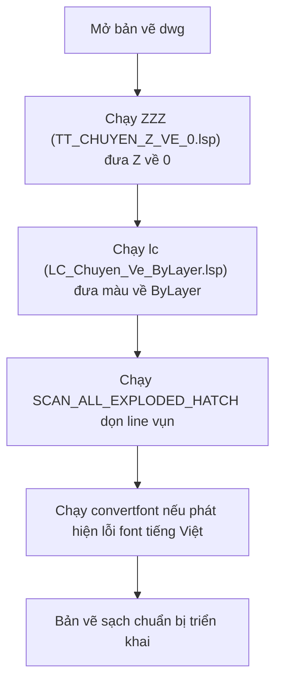

# CẨM NANG HƯỚNG DẪN AI SỬ DỤNG BỘ CÔNG CỤ AUTOLISP (DỰ ÁN LA635)

> **Dành cho:** AI Assistant (Antigravity) & Kỹ sư triển khai CAD  
> **Repository:** [https://github.com/pthieu2094-gif/LA635](https://github.com/pthieu2094-gif/LA635)  
> **Thư mục mã nguồn:** `scripts/lisp/`  
> **Phiên bản:** 2.0 (Cập nhật toàn bộ thư viện CAD thực chiến)

---

## 1. NGUYÊN TẮC BẮT BUỘC KHI AI THAO TÁC AUTOCAD

1. **Tuyệt đối không tự ý lưu đè bản vẽ:**
   - Khi chỉnh sửa hoặc chạy LISP tự động, **chỉ lưu file `LA325.dwg` khi người dùng đã xác nhận hoặc khi hoàn thành toàn bộ quy trình kiểm tra**.
2. **Luôn làm phẳng bản vẽ 2D về $Z = 0$:**
   - Trước khi đo đạc, gióng hàng, bắt điểm hoặc hatch, luôn nạp và chạy `TT_CHUYEN_Z_VE_0.lsp` (lệnh `ZZZ`) để đưa toàn bộ tọa độ $Z$ về $0.0$.
3. **Tránh kẹt Command Prompt (Dialog Freeze):**
   - Không gọi lệnh kích hoạt hộp thoại (GUI dialog) qua `SendCommand`. Luôn dùng dạng dòng lệnh có dấu gạch ngang phía trước: `_.-HATCH`, `_.-INSERT`, `_.-LAYER`, `_.-PURGE`.
   - Khi tạo Hatch qua ActiveX COM, ưu tiên dùng phương thức `ModelSpace.AddHatch(0, "LINE", True)` kết hợp `AppendOuterLoop` thay vì gõ lệnh `HATCH` thô.
4. **Phòng tránh trùng đè đối tượng (Duplicate Entities):**
   - Khi mirror, copy hoặc chạy lisp nhân bản, luôn kiểm tra số lượng đối tượng trước và sau để phát hiện trùng nét.

---

## 2. BẢNG TRA CỨU DANH MỤC 9 MODULE AUTOLISP (`scripts/lisp/`)

### Module 1: `architecture/` — Tiện ích Kiến trúc
| File LISP | Lệnh gọi | Công năng | Khi nào AI nên dùng? |
| :--- | :--- | :--- | :--- |
| `TT_DOOR.lsp` | `door` | Vẽ & chèn cửa đi kiến trúc theo kích thước chuẩn | Khi tạo các cửa đi lọt lòng trên tường |
| `TT_STAIRCASE_V1.lsp` | `cc` | Tự động tính toán & chia bậc cầu thang | Khi vẽ cầu thang bộ, mặt cắt thang, mặt bằng thang |
| `TT_VE_DO_DOC_SLOPE.lsp` | `S1` | Vẽ tam giác độ dốc và ghi chú $i\%$ | Khi thể hiện hướng dốc và độ dốc mái thoát nước |
| `TT_DRAW_SLOPE_XLINE.lsp` | `s2` | Bắn tia dóng `XLINE` theo góc nghiêng dốc mái | Khi dựng mặt đứng/mặt cắt mái tôn |
| `Pick_Dien_Tich_Phong.lsp` | `32` | Pick điểm tính diện tích phòng và ghi vào text | Khi tính diện tích phòng để ghi chú trên mặt bằng |

### Module 2: `structure/` — Tiện ích Kết cấu & Thép tiền chế
| File LISP | Lệnh gọi | Công năng | Khi nào AI nên dùng? |
| :--- | :--- | :--- | :--- |
| `TT_DAT_COT_TRUC.lsp` | `SCL1` | Tự động đặt cột vào các giao điểm lưới trục | Khi dựng mới hệ kết cấu cột tầng 1 hoặc tầng 2 |
| `Q_TRUC_PRO.lsp` | `R1`, `R2`, `R3`, `R4` | Tiện ích nâng cao dựng trục kết cấu | Khi vẽ các hệ trục phụ hoặc trục xiên |
| `VLT_Ve_Luoi_Truc_V7.VLX` | `VLT` | Bộ công cụ vẽ lưới trục tự động V7 | Dựng hệ trục định vị nhanh |
| `DLT_Danh_So_Luoi_Truc.VLX` | `DLT` | Đánh số và chữ cái bong bóng trục tự động | Khi đổi tên trục 1..8 hoặc A..C |
| `TT_COT_DAM_MC6.lsp` | `fc`, `wc`, `BMC6`, `DMC6`, `ST` | Vẽ cột, dầm, liên kết mặt cắt thép MC6 | Triển khai chi tiết khung nhà thép |
| `TT_VE_MAT_CAT_THEP_TO_HOP.lsp` | `VI` | Vẽ mặt cắt thép tổ hợp hình chữ I/H | Khi vẽ dầm thép chính và cột thép tổ hợp |
| `TT_VE_GIANG_X.lsp` | `x1`, `x2` | Vẽ hệ giằng chéo X (Bracing) | Triển khai giằng mái và giằng cột |
| `TT_TI_GIANG_2V25.lsp` | `TI` | Vẽ chi tiết ti giằng xà gồ 2V25 | Chi tiết liên kết xà gồ mái |
| `TT_V45_KEO_TI.lsp` | `VKN`, `VKD` | Vẽ thép góc V45 chống lật / kéo ti | Chi tiết giằng xà gồ biên |
| `TT_SLOT_HOLE.lsp` | `OV` | Vẽ lỗ oval bu lông liên kết (Slot hole) | Mặt cắt chi tiết liên kết chân cột / dầm |
| `TT_BU_LONG_NEO_V4.VLX` | `BLN` | Vẽ bu lông neo chân cột tự động V4 | Chi tiết móng và chân cột thép |
| `TT_DUONG_BAO_BU_LONG.lsp` | `BDT` | Vẽ đường bao liên kết bu lông | Chi tiết mặt cắt liên kết bu lông |
| `TT_BAN_MA_NGAM.lsp` | `BMN` | Vẽ bản mã ngầm chân cột | Chi tiết kết cấu ngầm |
| `TT_ENDPLATE_SIKAGROUT.lsp` | `1E` | Vẽ chi tiết bản mã đầu cột Endplate và lớp vữa SikaGrout | Chi tiết gối dầm / chân cột |
| `TT_BRACING_X.VLX` | `BRC` | Bộ công cụ vẽ hệ giằng X tự động | Dựng giằng không gian 3D/2D |
| `TT_LIEN_KET_DAU_HOI_EW1.VLX` | `EW1` | Dựng chi tiết liên kết đầu hồi nhà xưởng | Chi tiết khung đầu hồi Trục 1 & Trục 8 |
| `TT_PORTAL.VLX` | `PORTAL` | Vẽ khung Tiền chế Portal Frame | Dựng sơ đồ khung ngang nhà xưởng |
| `TT_TIET_DIEN_TD1.lsp` | `TD1` | Thể hiện ký hiệu tiết diện thép | Ghi chú quy cách thép trên mặt cắt |
| `TT_BAN_MA_PLATE.lsp` | `BM` | Vẽ bản mã liên kết phẳng | Chi tiết bản mã nút khung |
| `TT_MC1.VLX`, `MC3`, `MC4`, `MC6` | `MC1`..`MC6` | Bộ thư viện vẽ các loại mặt cắt kết cấu thép chuẩn | Triển khai hồ sơ kết cấu thép hoàn chỉnh |
| `Tien_Ich_Ve_Ket_Cau.lsp` | `CLD`, `mc`, `ov`, `VI`, `CB`... | Bộ lệnh tắt thao tác kết cấu | Thao tác nhanh với các cấu kiện thép |

### Module 3: `annotation/` — Ghi chú Kích thước & Cao độ
| File LISP | Lệnh gọi | Công năng | Khi nào AI nên dùng? |
| :--- | :--- | :--- | :--- |
| `TT_TAO_DIM.lsp` | `DS` | Khởi tạo hệ thống DimStyle kiến trúc chuẩn | Khởi tạo style kích thước chuẩn khi mở file |
| `TONG_HOP_Chinh_Dim_Layer.lsp` | `DS`, `TOP`, `HI`, `Q1`, `Q2`... | Bộ lệnh tắt căn chỉnh đường kích thước | Căn lề, đổi chân dim, chuyển layer dim |
| `TT_TDTL_LAYER_DIM.lsp` | `TDTL` | Chuyển layer và đổi tỉ lệ Dim nhanh | Đưa toàn bộ kích thước về layer `21 Dim` |
| `TT_SPACE_DIM.lsp` | `SD` | Dóng đều khoảng cách các hàng Dim (Space Dim) | Tránh các hàng dim đè sát nhau hoặc lệch khoảng cách |
| `Auto_Cut_Dimension_CD_BD.lsp` | `CD`, `BD` | Cắt ngắn chân dim (`CD`) và bẻ chân dim (`BD`) | Xử lý chân dim đâm xuyên qua tường / thiết bị |
| `TT_TEXT_DIM_BELOW.lsp` | `TD` | Thêm dòng chữ ghi chú bên dưới đường dim | Ghi chú "THÔNG THỦY", "TIM TƯỜNG", "KT" |
| `TT_UPDATE_CAO_DO.lsp` | `CAODO` | Cập nhật tự động ký hiệu và trị số cao độ | Mặt đứng và mặt cắt khi thay đổi cốt sàn |
| `TT_CANH_LEADER_TEXT.lsp` | `all`, `alr` | Căn lề trái / phải cho Leader và Text | Căn thẳng hàng khối ghi chú chỉ dẫn |
| `TT_ADD_LEADER.lsp` | `AD1` | Thêm nhanh đường dẫn chú thích Leader | Thêm mũi tên trỏ vào chi tiết |
| `TT_TAG_MULTILEADER.lsp` | `TAG` | Gắn tag Multileader tự động | Đánh số chi tiết hoặc mã cấu kiện |
| `LISP_TAG_GHI_CHU.lsp` | `TG` | Gắn tag ghi chú vật liệu | Ghi chú lớp hoàn thiện sàn/mái |
| `TT_KHOANH_MAY_REV.lsp` | `REV` | Vẽ đám mây Revision ghi chú sửa đổi | Khoanh vùng thay đổi theo comment |

### Module 4: `text_tables/` — Xử lý Văn bản, Bảng biểu & Thuộc tính Block
| File LISP | Lệnh gọi | Công năng | Khi nào AI nên dùng? |
| :--- | :--- | :--- | :--- |
| `TT_COPY_TEXT.lsp` | `d1` | Copy nội dung text nguồn sang text đích | Sao chép tên phòng, mã cấu kiện trong 1 click |
| `TONG_HOP_Chinh_Sua_Text.lsp` | `TC`, `tv`, `yu`, `YY`, `XO`, `TY` | Căn chỉnh lề, đổi hoa/thường, sửa chuỗi | Chuẩn hóa toàn bộ text về cùng format |
| `Tien_Ich_Text_Toan_Dien.lsp` | `RT`, `CTT`, `ct`, `OD`, `TKT`... | Cộng trừ số trong text, tính toán, thống kê | Xử lý bảng tính, cộng khối lượng trực tiếp trên CAD |
| `Copy_Tang_Dan_COT.lsp` | `cot` | Copy text có số/chữ cái tăng dần tự động | Đánh số thứ tự bậc thang, cọc, cửa, trục |
| `TT_CONVERT_FIELD_TO_TEXT.lsp` | `f2t` | Chuyển Dynamic Field thành Text tĩnh | Chống lỗi nhảy số `####` khi mang sang máy khác |
| `Edit_Truc_Tiep_Text_ATT.lsp` | `edt`, `edt1` | Sửa text trong Block Attribute trực tiếp | Sửa thông tin khung tên không cần bật dialog |
| `Match_Text_Vao_ATT_Block.lsp` | `t2a`, `t2a1` | Gán nội dung text ngoài vào thuộc tính block | Cập nhật tên bản vẽ hàng loạt từ danh sách |
| `Thong_Ke_Text_Ra_Bang.lsp` | `tkt` | Quét text trên bản vẽ và xuất ra bảng CAD | Lập bảng danh mục phòng, bảng thông kê |
| `Xuat_Toa_Do_CAD_Excel_XTD.lsp` | `XTD` | Pick điểm xuất bảng tọa độ X, Y ra CAD/Excel | Lập bảng tọa độ cọc móng, định vị công trình |
| `Xuat_Toa_Do_Nhieu_Doi_Tuong_ATX.lsp` | `atx` | Xuất tọa độ hàng loạt đối tượng ra Excel | Trích xuất dữ liệu tim cột, tim cọc sang Excel |
| `TT_XUAT_DANH_SACH_BAN_VE.lsp` | `eatt` | Quét khung tên xuất danh sách bản vẽ | Lập bảng mục lục hồ sơ phát hành |
| `TT_XUAT_DANH_SACH_KHUNG_TEN_ATAD.lsp` | `EAT1` | Xuất danh sách khung tên chuẩn ATAD | Quét nhanh khung tên công trình nhà xưởng |

### Module 5: `blocks/` — Quản lý & Hiệu chỉnh Block
| File LISP | Lệnh gọi | Công năng | Khi nào AI nên dùng? |
| :--- | :--- | :--- | :--- |
| `LM_ChangeBlockBasePoint.lsp` | `CBP`, `CBC` | Đổi điểm đặt block mà **không làm lệch vị trí** | Sửa tâm cột, mép cửa mà bản vẽ không bị xê dịch |
| `LM_CopyRenameBlock.lsp` | `cb`, `rr` | Nhân bản và đổi tên block trực tiếp | Tạo biến thể mới (VD: cửa mở ngược, cửa kích thước khác) |
| `DTB_Doi_Ten_Block.lsp` | `DTB` | Đổi tên định danh Block trong cơ sở dữ liệu | Chuẩn hóa tên block theo quy ước dự án |
| `TT_THAY_THE_BLOCK.lsp` | `TTB` | Thay thế hàng loạt block này bằng block khác | Thay block thiết bị WC, block đèn, block cửa |
| `TT_RENAME_BLOCK_RB1.lsp` | `RB1` | Đổi tên block nhanh chóng | Quản lý tên block gọn gàng |

### Module 6: `cad_cleanup/` — Làm sạch & Chuẩn hóa Hình học 2D
| File LISP | Lệnh gọi | Công năng | Khi nào AI nên dùng? |
| :--- | :--- | :--- | :--- |
| `TT_CHUYEN_Z_VE_0.lsp` | `ZZZ` | Đưa toàn bộ đối tượng về mặt phẳng $Z = 0$ | Bắt buộc chạy đầu tiên để chống lỗi bắt điểm xiên |
| `joinline.lsp` | `nn` | Nối Line/Arc rời rạc thành Polyline kín (`Closed`) | Bắt buộc chạy trước khi Hatch tường |
| `tl.lsp` | `TL` | Đo & tính tổng chiều dài nhiều đoạn nét chọn lọc | Đo tổng chiều dài tường, chu vi phòng, chiều dài dây |
| `Break_Curve_Tai_1_Diem_BRN.lsp` | `brn` | Bẻ ngắt đường tại đúng 1 điểm pick chuột | Cắt tường, ngắt dầm mà không làm mất đoạn nét |
| `Rai_Doi_Tuong_RDT.lsp` | `rdt` | Rải đều đối tượng theo đường dẫn / khoảng cách | Rải xà gồ, rải đèn, rải bố trí thiết bị |
| `LC_Chuyen_Ve_ByLayer.lsp` | `lc` | Chuyển toàn bộ màu sắc, nét vẽ về `ByLayer` | Chuẩn hóa bản vẽ nhận từ bên ngoài về đúng layer |
| `TT_CANH_DIEM_DAU_LINE.lsp` | `BLB`, `BLT`, `BLL`, `BLR` | Căn gióng đầu mút line theo 4 hướng | Làm phẳng mép tường, căn đều các đầu dầm |
| `TT_SNAP_ON.lsp` | `5` | Bật toàn bộ chế độ Osnap bắt điểm chuẩn | Đảm bảo độ chính xác khi vẽ thủ công |
| `TT_BUI_THANH_TRI.lsp` | `tri`, `d1`, `r1`... | Thư viện lệnh tổng hợp Bùi Thanh Trí | Bộ phím tắt tốc độ cao |
| `TT_SHOW_DXF_CODE.lsp` | `show` | Hiển thị mã DXF của đối tượng được pick | Tra cứu entity data (DXF group codes) để debug |

### Module 7: `layers_views_print/` — Quản lý Layer, Viewport & In ấn
| File LISP | Lệnh gọi | Công năng | Khi nào AI nên dùng? |
| :--- | :--- | :--- | :--- |
| `TONG_HOP_Chuyen_Layer.lsp` | `31`, `22`, `21`, `11`, `32`... | Phím số chuyển nhanh layer | Chuyển nhanh layer đối tượng chỉ bằng 1 phím gõ |
| `TT_LAYON_ALL.lsp` | `T5` | Bật lại toàn bộ layer đang bị ẩn | Khi cần rà soát lại toàn cảnh bản vẽ |
| `FFx_Loc_Doi_Tuong.lsp` | `FF`, `ffd`, `fft`, `ffh`... | Lọc chọn nhanh đối tượng tương tự | Chọn riêng tất cả Dim (`ffd`), Text (`fft`), Hatch (`ffh`) |
| `TT_TIEN_ICH_KHAC.lsp` | `InVis`, `Vis`, `SF`, `EE`... | Ẩn/hiện chọn lọc, xóa nhanh, lọc đối tượng | Giấu tạm đối tượng để vẽ vùng phức tạp |
| `TT_KHOA_VIEWPORT.lsp` | `W` | Khóa / mở khóa Viewport Layout | Khóa khung nhìn để tránh pan/zoom làm mất tỉ lệ |
| `VIEWPORT_LOCK_Z.lsp` | `Z` | Tiện ích khóa khung nhìn layout | Khóa bảo vệ bản vẽ Layout trước khi bàn giao |
| `TT_LAYOUT_MODEL_TAB.lsp` | `MM` | Chuyển nhanh giữa tab Model và Layout | Điều hướng nhanh trong bản vẽ lớn |
| `TT_FIELD_SCALE_VIEWPORT.lsp` | `FS` | Cập nhật tỉ lệ viewport vào text field | Tự động điền tỉ lệ 1/100, 1/50 vào khung tên |
| `TT_SCALE_NHANH.lsp` | `GG` | Thay đổi tỉ lệ đối tượng theo hệ số | Scale nhanh chi tiết phóng to |
| `IN_TPL_MP_Hang_Loat.VLX` | `IN` | In hàng loạt bản vẽ trong Model / Layout ra PDF | Xuất toàn bộ hồ sơ nộp ra file PDF |
| `convertfont.VLX` | `convertfont` | Chuyển đổi mã font chữ TCVN3 / VNI sang Unicode | Sửa lỗi tiếng Việt bị lỗi font |

### Module 8 & 9: `b01_standards/` & `b02_implementation/`
- Chứa các LISP đặc thù phục vụ riêng cho công trình B01 (Nhà giặt ủi) và B02 (Nhà bảo dưỡng) như đã nêu tại tài liệu tiến độ.

---

## 3. CÁC QUY TRÌNH NGHIỆP VỤ MẪU CHO AI (STEP-BY-STEP WORKFLOWS)

### Quy trình 1: Tiếp nhận và làm sạch bản vẽ CAD mới

### Quy trình 2: Triển khai Tường và Hatch chuẩn mực
1. Vẽ tim trục bằng layer `32 Gridline`.
2. Offset hoặc vẽ mép tường bằng layer `31 Drawing`.
3. Gõ lệnh `nn` (`joinline.lsp`) quét chọn toàn bộ nét tường để nối thành các đường **Closed Polyline**.
4. Kiểm tra thuộc tính `Closed = True`.
5. Tạo Hatch mặt cắt tường:
   - Dùng layer `22 Hatch`.
   - Pattern: `LINE`, góc $45^\circ$, scale $50.0$.

### Quy trình 3: Bố trí Cửa & Cầu thang
1. **Cửa đi:** Gõ `door` (`TT_DOOR.lsp`), nhập bề rộng lọt lòng (VD: $900\text{ mm}$, $1200\text{ mm}$), pick điểm mở cửa.
2. **Cầu thang:** Gõ `cc` (`TT_STAIRCASE_V1.lsp`), nhập bề rộng mặt bậc chuẩn **$250\text{ mm}$**, pick điểm bắt đầu và hướng lên.
3. Đánh số bậc: Dùng `cot` (`Copy_Tang_Dan_COT.lsp`) để copy số thứ tự $1, 2, 3...$ tự động vào từng bậc thang.

### Quy trình 4: Triển khai Kích thước (Dimension) & Cao độ
1. Thiết lập dim: Gõ `DS` (`TT_TAO_DIM.lsp`).
2. Kéo kích thước chi tiết và kích thước tổng thể bằng layer `21 Dim`.
3. Cắt ngắn chân dim: Gõ `CD` (`Auto_Cut_Dimension_CD_BD.lsp`) pick đường cắt để chân dim không đâm vào nét vẽ kiến trúc.
4. Dóng đều các hàng dim: Gõ `SD` (`TT_SPACE_DIM.lsp`), chọn các đường dim song song để cách đều nhau đều đặn.
5. Ghi chú cao độ: Gõ `CAODO` (`TT_UPDATE_CAO_DO.lsp`), pick mốc sàn để tự động cập nhật số đo cốt $\pm 0.000$, $+3.600$...

### Quy trình 5: Xử lý Block không làm lệch tọa độ
- **Khi muốn dời tâm block:** Không dùng lệnh `EXPLODE` rồi tạo lại. Sử dụng `CBP` (`LM_ChangeBlockBasePoint.lsp`), pick điểm đặt mới. Toàn bộ các block cùng tên trong bản vẽ sẽ đổi tâm mà **vị trí hình học giữ nguyên 100%**.
- **Khi muốn tạo cửa mở ngược:** Dùng `cb` (`LM_CopyRenameBlock.lsp`) để nhân bản block sang tên mới (VD: `B02_DOOR_D5_MIRROR`), sau đó mới sửa nét bên trong.

### Quy trình 6: Đóng gói và Xuất hồ sơ
1. Chuyển đổi Field thành text tĩnh: Gõ `f2t` (`TT_CONVERT_FIELD_TO_TEXT.lsp`).
2. Khóa tất cả các khung nhìn Viewport trong layout: Gõ `W` (`TT_KHOA_VIEWPORT.lsp`).
3. Xuất danh sách bản vẽ: Gõ `eatt` (`TT_XUAT_DANH_SACH_BAN_VE.lsp`) để trích xuất mục lục bản vẽ.
4. In ấn hàng loạt: Gõ `IN` (`IN_TPL_MP_Hang_Loat.VLX`) để xuất PDF đồng bộ.

---

## 4. XỬ LÝ SỰ CỐ & GOTCHAS KHI AI GỌI LISP TỰ ĐỘNG

| Tình huống / Lỗi | Nguyên nhân | Giải pháp xử lý |
| :--- | :--- | :--- |
| **Command prompt bị treo (Kẹt dòng lệnh)** | LISP gọi hàm `(getpoint)` hoặc `(getstring)` mà không nhận được input, hoặc prompt đang ở trong lệnh con | Gửi chuỗi `\e\e` (tương đương 2 lần bấm phím ESC) qua ActiveX `SendCommand` để thoát lệnh |
| **Hatch báo lỗi `Unknown pattern`** | Lệnh `HATCH` AutoCAD phiên bản mới yêu cầu định dạng tên pattern khác nhau giữa các locale | Dùng phương thức COM `ModelSpace.AddHatch(0, "LINE", True)` kèm `AppendOuterLoop` và `Evaluate()` |
| **Bắt điểm bị lệch trong không gian 3D** | Bản vẽ có đối tượng mang cao độ $Z \ne 0$ | Chạy ngay `ZZZ` (`TT_CHUYEN_Z_VE_0.lsp`) trước khi bắt điểm |
| **Block bị nhảy vị trí lung tung khi đổi tên** | Do đổi base point thủ công trong Block Editor mà không bù vector dời | Luôn dùng `CBP` (`LM_ChangeBlockBasePoint.lsp`) để bảo toàn tọa độ thế giới |
| **Tường không hatch được** | Polyline viền tường chưa khép kín (`Closed = False`) | Chạy lệnh `nn` (`joinline.lsp`) để hàn kín toàn bộ mút hở |
| **File `.dwg` bị lock khi Git thao tác** | AutoCAD đang mở file và giữ lock độc quyền | Dùng MCP tool `drawing_close` để đóng tạm bản vẽ trước khi Git merge/rebase, sau đó mở lại bằng `drawing_open` |
